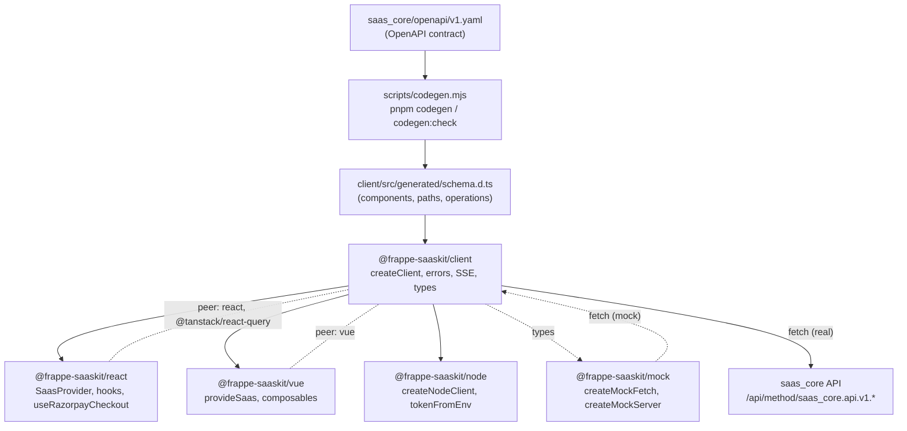
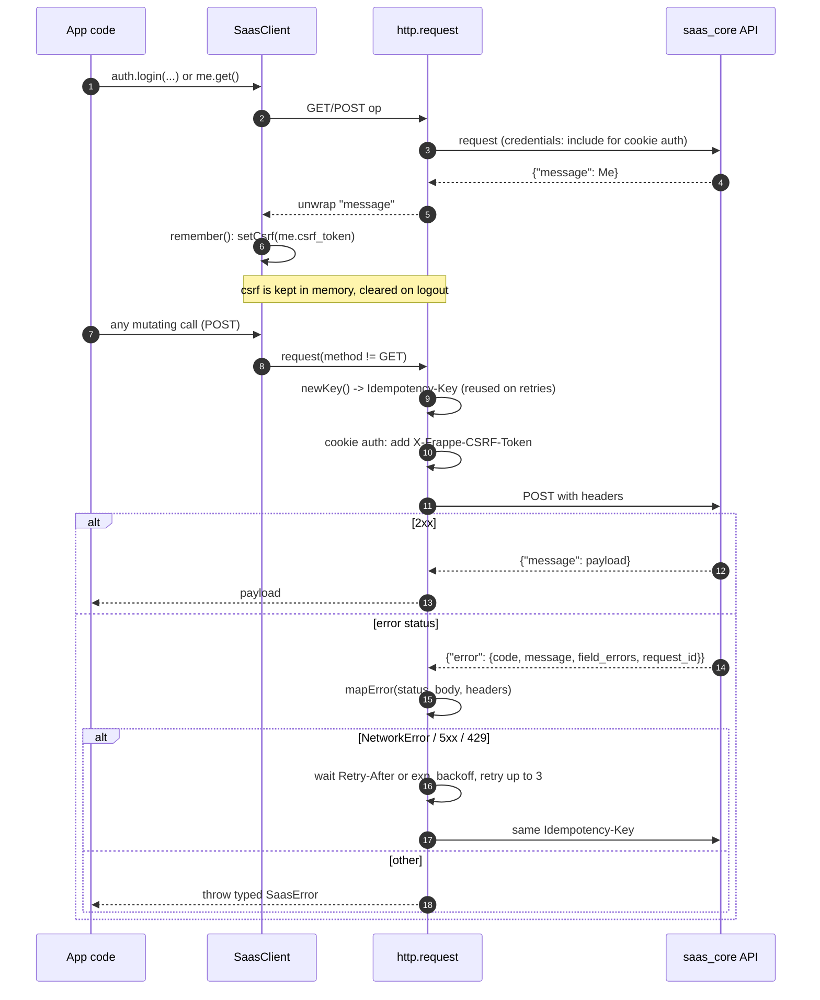
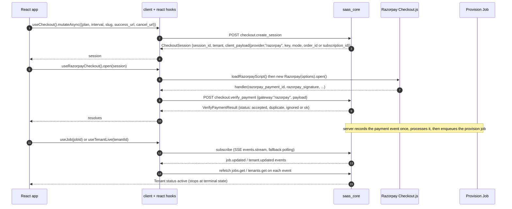
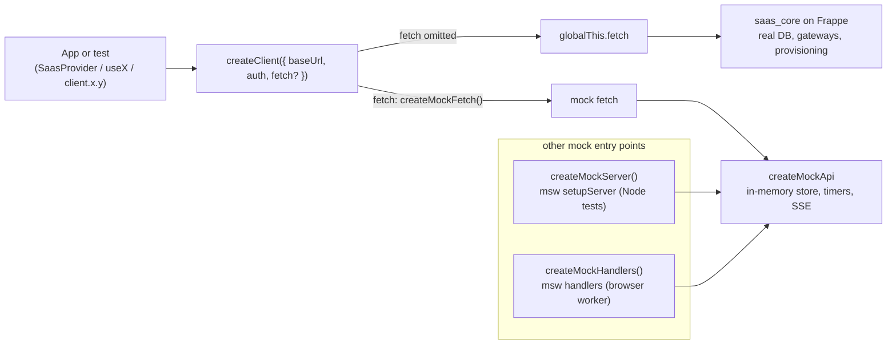

# saas-kit architecture

How the `@frappe-saaskit/*` packages fit together and what happens on the wire. Every diagram below is rendered to SVG in [`img/`](img/) as a fallback for viewers that do not render Mermaid (the SVG is linked under each diagram).

Facts here come from the source: `packages/*/src/index.ts`, `packages/client/src/{client,http,sse,errors}.ts`, `packages/react/src/razorpay.ts` and `packages/mock/src/*`.

## 1. Package map

`@frappe-saaskit/client` is the only package that talks HTTP. Its types are generated from the saas_core OpenAPI contract (`../saas_core/openapi/v1.yaml`) by `scripts/codegen.mjs` into `packages/client/src/generated/schema.d.ts`. `react`, `vue` and `node` are thin layers over the client. `mock` depends on the client types and answers the same URLs from memory.

SVG fallback: [img/package-map.svg](img/package-map.svg)

| Package | Runtime deps | Entry points (from `src/index.ts`) |
|---|---|---|
| client | `openapi-fetch` | `createClient`, `SaasClient`, `ClientOptions`, `AuthStrategy`, `RetryOptions`, error classes, `TERMINAL_JOB_STATES`, `STABLE_TENANT_STATUSES`, `components`/`paths`/`operations` |
| react | client (workspace), peers `react`, `@tanstack/react-query` | `SaasProvider`, `useSaasClient`, `saasKeys`, all hooks, `useRazorpayCheckout`, `loadRazorpayScript`, `RAZORPAY_SCRIPT_URL` |
| vue | client (workspace), peer `vue` | `provideSaas`, `useSaasClient`, `SAAS_CLIENT_KEY`, composables (`usePlans`, `useCheckout`, `useJob`, ...) |
| node | client (workspace) | `createNodeClient`, `tokenFromEnv`, `loadTokenFile` |
| mock | client (workspace), `msw` | `createMockFetch`, `createMockHandlers`, `createMockServer`, `createMockApi` |

Contract drift is caught by `pnpm codegen:check` (CI); it exits non-zero if `schema.d.ts` no longer matches the spec.

## 2. Request lifecycle: CSRF, auth and the error envelope

All calls go through `createHttp` in `client/src/http.ts`. URL shape is `<baseUrl>/api/method/saas_core.api.v1.<op>`, so `baseUrl` is the site origin (use `''` for same-origin), not an `/api/v1` path.

SVG fallback: [img/request-lifecycle.svg](img/request-lifecycle.svg)

- **Auth modes** (`AuthStrategy`): `{ type: 'cookie' }` (browser; CSRF token comes from `Me.csrf_token` after `login`, `signup`, `me.get` or `me.update`), `{ type: 'apiKey', key, header? }` (`Authorization: token <key>` unless a custom header is set), `{ type: 'bearer', getToken }` (`Authorization: Bearer <token>`, resolved per request).
- **CSRF** is only attached for cookie auth on non-GET requests.
- **Envelope**: Frappe wraps whitelisted responses as `{ "message": <payload> }`; the client unwraps it. Errors carry `{ error: { code, message, field_errors, request_id, retry_after } }`, also unwrapped from `message` if needed.
- **Error mapping** (`mapError`):

| Status | Class | Retried |
|---|---|---|
| 401 | `AuthError` | no |
| 403 | `ForbiddenError` | no |
| 404 | `NotFoundError` | no |
| 409 | `ConflictError` | no |
| 400, 422 | `ValidationError` (`fieldErrors`) | no |
| 429 | `RateLimitError` (`retryAfterMs` from `Retry-After` or `retry_after`) | yes |
| 5xx | `ServerError` | yes |
| fetch failure | `NetworkError` | yes |
| other | `SaasError` | no |

All extend `SaasError` (`status`, `code`, `fieldErrors`, `requestId`). Retries default to 3 with exponential backoff and jitter (`RetryOptions`: `retries`, `baseDelayMs` 250, `maxDelayMs` 5000).

## 3. Checkout with Razorpay

The server decides the price and the gateway; the browser only receives a `client_payload` to open Razorpay Checkout.js and then posts the signed result back for server-side verification. Provisioning starts on the server once the payment is recorded, and the UI follows the Provision Job.

SVG fallback: [img/checkout-razorpay.svg](img/checkout-razorpay.svg)

Details that matter:

- `session.client_payload.mode` is `subscription` (Razorpay `subscription_id`) or `order` (`order_id`, `amount`, `currency`). If the server could not create a Razorpay subscription it falls back to a one-time order and the response carries `fallback: "invoice"` (not in the generated type); `open()` handles both without changes.
- `open()` rejects with `Error('dismissed')` if the user closes the modal and with the gateway description on `payment.failed`. It throws if `client_payload.provider !== 'razorpay'`.
- `verifyPayment` and the gateway webhook converge on the same server-side event record, so the callback and the webhook can both arrive without double-provisioning.
- Provisioning polling: `useJob(id)` and `useTenantLive(id)` subscribe through `client.subscribe` (SSE with `Last-Event-ID` reconnect, falling back to polling `jobs.get` / `tenants.get` every `pollIntervalMs`, default 2000). They stop at `TERMINAL_JOB_STATES` (`succeeded`, `failed`, `needs_attention`, `outcome_unknown`) or `STABLE_TENANT_STATUSES` (`active`, `failed`, `suspended`).
- When the mock gateway reports `payment_mocked: true`, the session is already active and no checkout widget is needed (`subscription_status: "active"`).

## 4. Mock vs real adapter

`createClient` takes an optional `fetch`. Real use leaves it unset (global `fetch`); tests and demos pass the mock. Both answer the same `/api/method/saas_core.api.v1.*` URLs with the same envelope, so application code does not change.

SVG fallback: [img/mock-vs-real.svg](img/mock-vs-real.svg)

| Concern | Real | Mock |
|---|---|---|
| Transport | `globalThis.fetch` to saas_core | `createMockFetch()` (no msw), or msw via `createMockServer()` / `createMockHandlers()` |
| State | Frappe database | in-memory store; `reset()` restores seed data |
| Provisioning | Provision Job runner via fcctl | timed job ticks (`stepMs`, default 800) |
| Options | `ClientOptions` | `MockOptions`: `baseUrl`, `stepMs`, `pingMs`, `forceUnauthenticated`, `loggedIn`, `publicSignup` |
| Frappe Cloud credentials | never in the SDK | none needed |
